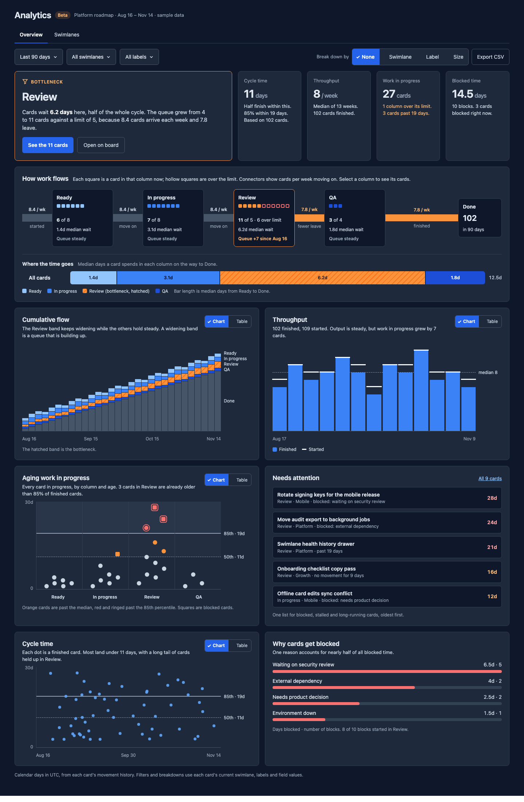
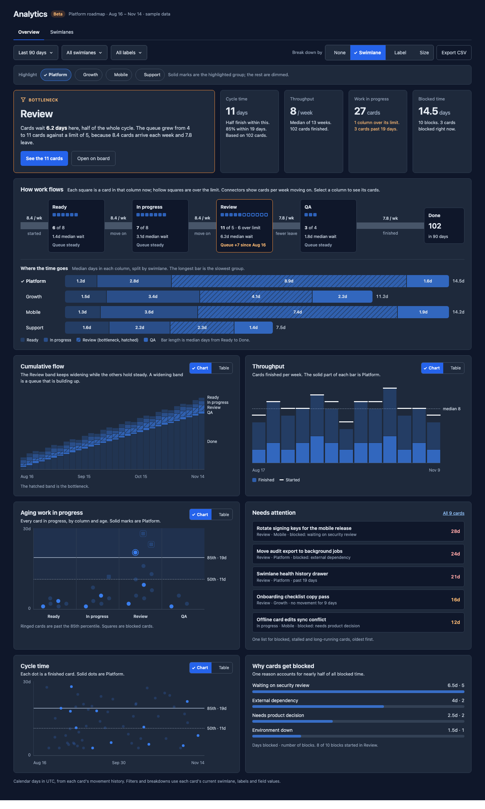
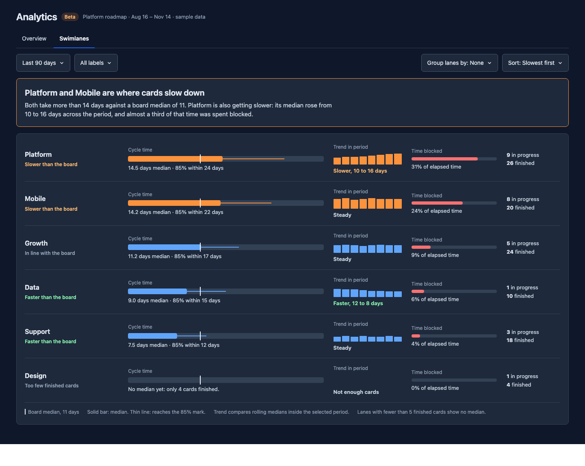
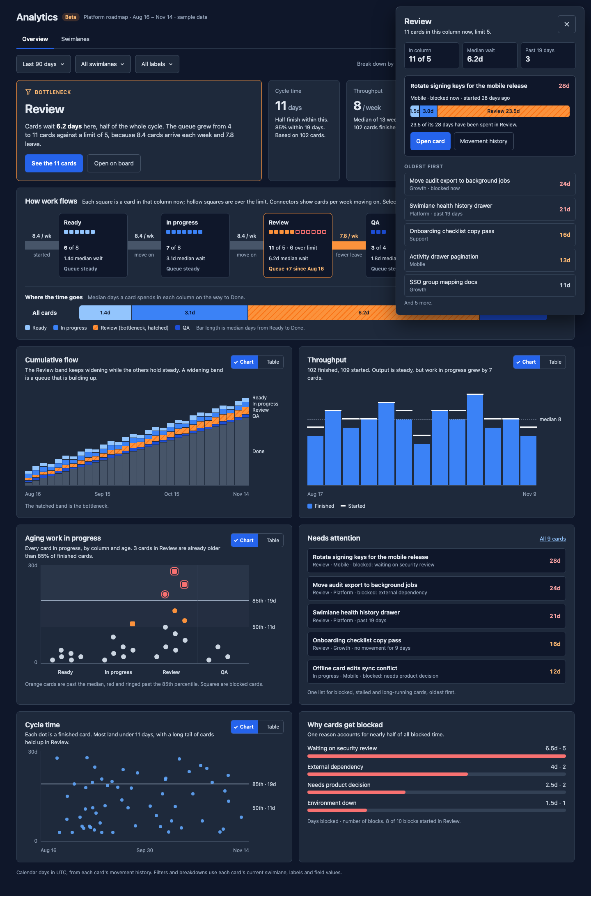
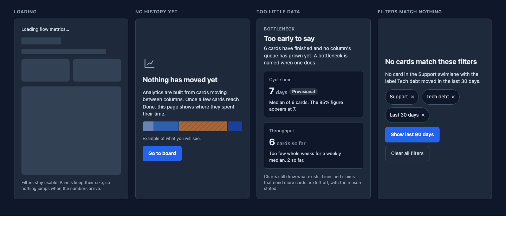
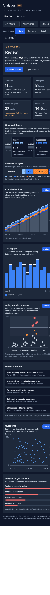

# Analytics tab redesign: what to build

This page is the build spec for the redesigned Analytics tab. It records the design so that an implementer who cannot open the design canvas can still build it exactly.

**Why it matters:** The current tab has three sections with three filter models, buries the bottleneck in a chart footnote, and puts the most actionable list last. The redesign answers "where is work stuck and what should I look at" before it shows a chart.

**Status:** Being built in stages. The work is tracked in #2257 (page restructure) and #458 (swimlane comparison and breakdowns), both labeled `analytics-redesign`.

**Watch out:** Every number in the screenshots is sample data. The screenshots approximate charts with plain boxes; build the real charts on `components/Common/Chart.tsx`.

## What wins when sources disagree

1. `frontend/CLAUDE.md`, including § Charts. The design follows it, with the three color exceptions that § Charts now lists for this tab; if another conflict remains, the rule wins and the conflict is a bug in this page.
2. This page.
3. The screenshots in `docs/development/analytics-redesign/`.
4. The artboard sources in `docs/development/analytics-redesign/artboards/`, for exact copy, order and spacing.

## Screenshots

| File | Shows |
|---|---|
| `overview-dark.png` | Overview tab, dark theme, 1440px |
| `overview-light.png` | Overview tab, light theme |
| `overview-drawer.png` | Overview with the Review column drawer open |
| `overview-by-swimlane.png` | Overview broken down by swimlane |
| `overview-phone.png` | Overview at 390px |
| `swimlanes.png` | Swimlanes tab |
| `states.png` | Loading, no history, too little data, filters match nothing |

## Page structure

The tab has two views, **Overview** and **Swimlanes**, switched by a row of two links under the page title.

- Build the switch as a `<nav>` of links with `aria-current="page"` on the active one, not an ARIA tablist. The active link is bold with an underline, so color is not the only cue.
- The Period and Label selections carry over when switching views.

Overview, top to bottom:

| # | Region | Width at 1024px and up | Issue |
|---|---|---|---|
| 1 | Title row: "Analytics", Beta badge, board name and date range | full | #2257 |
| 2 | View tabs: Overview, Swimlanes | full | #458 adds Swimlanes |
| 3 | Filter bar | full | #2257 |
| 4 | Group legend (only when a breakdown is on) | full | #458 |
| 5 | Bottleneck panel and four headline tiles | 2 : 3 | #2257 |
| 6 | How work flows, with Where the time goes | full | #2257 |
| 7 | Cumulative flow and Throughput | 1 : 1 | #2257 |
| 8 | Aging work in progress and Needs attention | 1 : 1 | #2257 |
| 9 | Cycle time and Why cards get blocked | 1 : 1 | #2257 |
| 10 | Footnote on days, time zone and current-value filters | full | #2257 |

Chart rows are two equal columns from `lg` and one column below, and a chart frame never grows past 760px, as § Charts requires.

## Filter bar

- **Period**, **Swimlane** and **Label** dropdowns, in that order, using `SingleSelectDropdown` with `portalMenu`. One selection drives every panel on the Overview.
- The Swimlanes view has Period and Label only. It has no Swimlane filter and no Break down by, because it already shows every swimlane.
- **Period options:** last 30, 90, 180 and 365 days. Default 90.
- **Break down by:** a segmented group with None, Swimlane, Label, and one entry per eligible card custom field (#458). The active segment carries `ActiveMark`.
- **Export CSV**, admin and site admin only, as today.
- The heatmap's own period pills are removed. Its mode toggle moves into the table view of "Where the time goes".

## Bottleneck panel

- Eyebrow "Bottleneck", then the column name as the panel heading.
- One sentence built from returned numbers: median wait in the column, its share of the cycle, queue size at the start and end of the period, the WIP limit when one is set, and cards arriving and leaving per week.
- Two buttons: a primary button that opens the column drawer ("See the N cards"), and "Open on board".
- The panel uses the warning border, because a named bottleneck is a system signal.
- **No bottleneck returned:** heading "Too early to say" or "No bottleneck", with the reason. See [States](#states).

## Headline tiles

Four tiles, each with a label, one large number with its unit, and one supporting sentence.

| Tile | Number | Supporting sentence |
|---|---|---|
| Cycle time | Median, in days | The 85th percentile and the sample size |
| Throughput | Median cards per week | Number of weeks and total finished |
| Work in progress | Every card not archived in a not-done column now, started or not (changed by #2287/#2293) | Columns over their limit and cards past the 85th percentile |
| Blocked time | Total days blocked | Number of blocks and cards blocked now |

### Withholding rules

These come from the flow-metric ADR (#1532) and `backend/boards/services/flow_metrics.py`. The server applies them; the page only reports the result.

| Value | Shown when | Otherwise |
|---|---|---|
| Median (50th percentile) | at least 5 finished cards | withheld, with the count so far |
| 85th percentile | at least 7 finished cards | withheld, with the count so far |
| 95th percentile | at least 20 finished cards | withheld |
| Weekly throughput median | the API returns one | withheld, with the reason |
| Bottleneck | a column's queue grew over the period | "No bottleneck" or "Too early to say" |

**Naming the threshold:** a tile or a Swimlanes row may name the card count at which a value appears ("appears at 7"). A chart note names no number, as the ADR requires.

**Where the sample size shows:** on the Cycle time tile; in each chart's notes, as `ChartPanel` does today ("102 cards."); and as the "finished" count on each Swimlanes row.

## How work flows

One row, left to right, inside a box that scrolls sideways when the panel is narrower than 980px.

- **Connector** before each column: cards per week entering it, a bar whose thickness is proportional to that rate, and a one- or two-word note.
- **Column box** for each in-progress column, as a button that opens the drawer:
    - column name
    - one square per card in the column now; squares beyond the WIP limit are hollow
    - "N of limit", plus "M over limit" when over
    - median wait
    - queue change over the period ("Queue +7 since Aug 16" or "Queue steady")
- The bottleneck column box has the warning border.
- A final connector and a **Done** box with the number finished in the period.
  - Shipped connector copy is "avg / wk" (a mean over the range), not the artboard's "cards per week" (#2307).

### Where the time goes

Under the flow row, in the same panel.

- One horizontal bar per group. With no breakdown there is one bar, "All cards".
- Each bar is segmented by in-progress column; a segment's width is the median days in that column and it is labeled with that number.
- The bar's total length is proportional to the group's total, so the longest bar is the slowest group. The sum of the medians is printed at the end, with a note of how many columns were left out for lack of data (changed by #2287/#2293).
- The bottleneck column's segment is hatched.
- This replaces the dwell heatmap as the lead visual. The heatmap is not deleted: it becomes this panel's **Table** view, behind the same Chart | Table switch the charts have. The screenshots do not draw that switch.
- The table is today's heatmap table: swimlane rows, column cells with the three-level cue, the velocity column, and the admin-only CSV export. Its period follows the filter bar.
- Its two modes stay but are renamed, because "Throughput" now means cards finished per week: "Age" becomes **Current** and "Throughput" becomes **In period**.

## Charts

All four charts keep the `ChartPanel` behavior they have today: summary sentence, Chart | Table switch, notes, table alternative, and drill-down.

| Chart | What changes |
|---|---|
| Cumulative flow | Layout position, and the bottleneck band is hatched in the warning color, with a one-item legend (a swatch drawn from `HATCH_SVG`) shown only while that band is drawn (#2284). Bands keep 1px separators and direct labels at the right edge; Done is neutral. |
| Throughput | Adds a "started" marker per week next to the finished bar. Median dashed, labeled in the right margin. |
| Aging work in progress | Layout position, and marks past the 50th percentile use the warning color and past the 85th the danger color. 50th percentile dashed, 85th solid and heavier, both labeled in the right margin. Ringed past the 85th, square when blocked. A legend lists the neutral, past-50th and past-85th tiers in the shapes the chart draws, each only while a mark of that tier is on screen, and none under a breakdown, where marks take group colors (#2284). |
| Cycle time | Layout position only. Same reference-line vocabulary. |

Color follows [Chart colors](#chart-colors). Shape and position still carry every meaning that color carries.

## Needs attention

One list that replaces the stalled-cards table.

- **Membership:** a card is listed once if it is blocked now, has not moved for longer than the stalled threshold, or is older than the 85th percentile.
- **Order:** oldest first.
- Membership and order come from one backend service, so the attention queue (#1358) can reuse it.
- **Row:** card title, then column, swimlane and the reason; age in days on the right. Selecting a row opens the card.
- **Age color:** `text-danger` when the card is past the 85th percentile, `text-warning` otherwise. Every card on this list is already flagged, so there is no neutral tier.
- Shows five rows. "All N cards" expands the list in place, 25 per page, like the stalled table today.

## Why cards get blocked

- A ranked list of block reasons, longest total first.
- Each row: reason, days blocked and number of blocks, and a bar proportional to days blocked, in the danger color.
- The subtitle is computed from the data (#2282). With one reason: "Every blocked day had the same reason." Top share of `total.days` (unrounded) at least 50%: "One reason accounts for more than half of all blocked time." At least 40% and under 50%: "One reason accounts for nearly half of all blocked time." Otherwise, or when `total.days` is 0: "Block reasons over the last N days, longest first."
- A footnote says where most blocks started.
- Renders nothing when no block overlapped the period, as today.

## Column drawer

Opens from a column box or from the bottleneck panel's primary button. Reuse `FlowDrillDrawer`.

- Heading: column name, and "N cards in this column now, limit L".
- Three figures: in column against the limit, median wait, cards past the 85th percentile.
- The oldest card expanded: title, age, swimlane and blocked state, a bar of its time by column, one sentence naming the time in this column, and an "Open card" button that opens the card detail (`onOpenCard`).
- The screenshot also shows a "Movement history" button. Do not build it; "Open card" already leads there.
- The remaining cards, oldest first. Five show at first; a "Show N more" button reveals the rest. The screenshot shows this as plain text.
- Opening, closing and focus return follow `FlowDrillDrawer` as it works today.

## Breakdowns (#458)

A breakdown colors marks by group, using the five categorical chart colors.

- **Where the time goes** shows one bar per group, with the group's color dot beside its name. The segments keep their column colors.
- A **group legend** appears under the filter bar: "Colored by swimlane" (or label, or the field name) and one chip per group with its color dot.
- Selecting a chip isolates that group: its marks stay at full strength and the rest drop to 20%. Selecting it again shows every group. The selected chip carries `ActiveMark`.
- **Throughput** bars stack by group. **Aging** marks and **Cycle time** dots take the group color; aging marks keep the ring and the square.
- Each chart's summary sentence says what the color means ("stacked by swimlane", "colored by label").
- Each chart's table view gains a group column, so color is never the only carrier.
- Cumulative flow does not change with a breakdown, because its color already means column.
- **Labels:** a card with several labels counts once in each group; the legend's note says so.
- **More than five groups** collapse to the five largest plus "Other", drawn in a neutral color.
- **Custom fields:** card fields of type dropdown or checkbox only. Cards with no value are left out, and the note says so.
- Filters use each card's current swimlane and labels. Breakdowns use each card's current labels and field values; a swimlane breakdown counts each sample under the swimlane the card was in when the sample is dated (completion, or now for work in progress), a dwell visit under the swimlane the card was in when it left the column, and blocked time under the swimlane it was spent in, and so does the Swimlanes tab (#2334; ADR #1532 "Filters", dated note).

## Swimlanes tab (#458)

- Same title row and view links. Controls: Period, Label, "Group lanes by" (None, or a swimlane custom field) and "Sort" (slowest first by default).
- A finding panel at the top names up to two swimlanes whose status is "slower", slowest first, in one heading and one sentence. When none is slower it says so.
- One row per swimlane:

| Cell | Content |
|---|---|
| Name | Swimlane name, linking to the Overview filtered to it, and a status line: slower than, in line with, or faster than the board |
| Cycle time | A bar for the median, a thin line reaching the 85th percentile, and a tick at the board median; then the two numbers in words |
| Trend in period | Eight small bars of the rolling median, and a word: slower, steady or faster, with the first and last values |
| Time blocked | A bar and "N% of elapsed time" |
| Counts | Cards in progress and cards finished |

- **Status** compares the swimlane's median with the board median: "Slower than the board" when more than 20% above, "Faster than the board" when more than 20% below, otherwise "In line with the board". A swimlane needs at least 10 finished cards to get a slower or faster status; with 5 to 9 it shows its median and no status line. Both numbers are constants, not settings.
- **Trend** compares the first and last rolling medians in the period with the same 20% threshold: "Slower, A to B days", "Faster, A to B days" or "Steady".
- **Bar scale** is shared by every row and runs from 0 to the largest 85th percentile on the page, rounded up to a round number. The board-median tick sits on that scale.
- A swimlane with fewer than five finished cards shows no median, no bar and no trend. Its cycle-time text says how many cards have finished and its trend text is "Not enough cards".
- A swimlane with five or six finished cards shows the median but no 85th-percentile line.
- A legend under the rows explains the board-median tick, the solid bar, the thin line and the trend.
- Status is stated in words. Color repeats it: a slower swimlane's bar, status and trend use the warning color, and a faster one's status uses the success color.
- The time-blocked bar uses the danger color.
- Below 1024px each row's cells wrap under the name.

## States

| State | What shows |
|---|---|
| Loading | Skeleton blocks the size of the final panels. Filters stay usable. |
| No history yet | Heading, one sentence on what the page will show, a dimmed example bar labeled as an example, and "Go to board". |
| Too little data | The page renders. The bottleneck panel says "Too early to say" with the reason. Tiles mark values "Provisional" and say what is withheld and when it will appear. |
| Filters match nothing | Heading, a sentence naming the active filters, a removable chip per filter, a "Show last 90 days" button when the period is shorter than that, and "Clear all filters". |

## Design tokens

The screenshots use literal colors. Build with the tokens.

| In the design | Token |
|---|---|
| Page background | `bg-page` (`--surface-page`: slate-100 light, slate-900 dark; Analytics root only, #2311) |
| Panel | `bg-surface border border-line rounded-lg` |
| Inset box (tile inside drawer, list row) | `bg-sunken border border-line` |
| Flow-row column box and Done box | `bg-sunken border border-line-strong`; hover is `hover:border-line-emphasis`, never a fill (#2311) |
| Control border | `border-line-strong` |
| Primary text | `text-fg` |
| Secondary text | `text-fg-secondary` |
| Labels, axis text, captions | `text-fg-tertiary` (never `fg-muted`) |
| Primary button | `bg-button-primary hover:bg-button-primary-hover text-on-primary` |
| Active segment | `bg-primary text-on-primary` with `ActiveMark` |
| Link | `text-info` |
| Bottleneck border and bottleneck-column queue growth | `border-warning` (the Bottleneck panel adds `ring-1 ring-inset ring-warning`), `text-warning` |
| Over-limit text, in the flow row and on the Work in progress tile | `text-danger font-semibold` |
| Queue growth in a non-bottleneck column | `text-fg-secondary font-semibold` with an `aria-hidden` `▲` |
| Headline tile | Label `text-xs font-semibold uppercase tracking-wide text-fg-tertiary`, number `text-3xl font-bold text-fg tabular-nums`, unit `text-sm text-fg-tertiary` |
| Age past the 85th percentile in a list | `text-danger` |
| Chart marks | See [Chart colors](#chart-colors) |
| Bar track | `bg-surface-hover` |

Smallest text is 12px everywhere.

### Chart colors

`frontend/CLAUDE.md` § Charts keeps one hue as the default and lists three exceptions for this tab. This table is the full mapping.

| Mark | Color |
|---|---|
| In-progress columns, in bands, time-bar segments and flow-row squares | The chart hue from light to dark in board order, one ramp: `columnAlpha` (0.55 to 1.0; one column 0.7). Time-bar gutter and band separators are `bg-surface` / `rgb(var(--surface))` |
| Done band | Neutral (`border-line-strong` tone) |
| Bottleneck column, everywhere it is drawn | `warning`, hatched |
| Squares over the WIP limit | Hollow, outlined in `danger` |
| Connectors in the flow row | `bg-line-emphasis`; `warning` after the bottleneck |
| Throughput bars and Cycle time dots, no breakdown | The chart hue |
| Aging marks, no breakdown | Neutral up to the 50th percentile, `warning` past it, `danger` and ringed past the 85th |
| Blocked-reason bars, time-blocked bars | `danger` |
| Swimlanes cycle-time bars | The chart hue; `warning` when the swimlane is slower than the board |
| Marks under a breakdown | Five new tokens, `--chart-cat-1` to `--chart-cat-5`, plus neutral for "Other" |
| Zones above the 50th and 85th percentile lines | Neutral tint, 5% and 10% |

The categorical tokens are new and belong in `frontend/src/index.css` with a dark and a light value each. The design uses:

| Token | Dark | Light |
|---|---|---|
| `--chart-cat-1` | blue-400 | blue-600 |
| `--chart-cat-2` | violet-400 | violet-600 |
| `--chart-cat-3` | teal-400 | teal-700 |
| `--chart-cat-4` | pink-300 | pink-700 |
| `--chart-cat-5` | yellow-300 | yellow-700 |

None of them is orange, red or green, which stay reserved for the signals above. `ux-review` confirms each against the contrast rules.

Cumulative flow bands stack bottom to top in board order from Done back to the first in-progress column.

## Phone width

- No sideways page scroll at 390px.
- Filter controls wrap. Tiles sit two per row. Every two-column row becomes one column.
- The flow row scrolls sideways inside its panel.

## What the API must return

All additions are additive; no existing field, endpoint or parameter changes. The `architect` gate decides field names and which endpoint carries each.

| Needed by | Number | Exists today |
|---|---|---|
| Bottleneck sentence, flow row | Cards per week entering and leaving each column | No |
| Bottleneck sentence, flow row | Queue size per column at the start and end of the period | Derivable from cumulative flow days |
| Flow row | WIP limit per column | Yes, on the column |
| Where the time goes | Median days per column for the selected filters | No (the heatmap returns averages) |
| Throughput | Cards started per week | No |
| Blocked tile and list | Blocked totals and reasons for the same period and filters as the flow charts | Partly: the analytics endpoint accepts 1 to 365 days and, from 1.3, optional `swimlane_id` and `label_id` filters |
| Needs attention | Stalled cards for the same period and filters | Partly: filtered by the optional `swimlane_id` and `label_id` on the analytics endpoint (1.3+) |
| Breakdowns (#458) | Each flow metric grouped by swimlane, label or custom field | No |
| Swimlanes tab (#458) | Rolling median and share of elapsed time blocked, per swimlane | No |

Percentiles and medians come from the server. The browser never computes one.

## What changes for existing features

| Today | After |
|---|---|
| Dwell heatmap as the first section | Table view of "Where the time goes"; same data, modes renamed, period from the filter bar |
| Heatmap CSV export | Unchanged, admin and site admin only |
| Stalled-cards table | Folded into "Needs attention" |
| Blocked-time table per column | Replaced by "Why cards get blocked"; the per-column figures stay in the cumulative flow and column drawer |
| Heatmap period pills (7, 30, 90 days) | Removed; the filter bar's period applies |

No shipped analytics feature is removed, which keeps the page inside the open-core ruling (#1750). The analytics endpoint keeps every field it returns today.

## Not part of this design

- #458's "card detail: show the card's own cycle time against its swimlane" has no design here. Leave it out unless it is designed separately.

## Docs to update when this is built

- `docs/features/analytics.md`: it describes the heatmap, the Age/Throughput toggle, the 7/30/90 pills, the stalled table and the blocked table, and uses "Throughput" for dwell time. After the change "Throughput" means cards finished per week everywhere.
- `docs/api/`: every added field and parameter.
- `frontend/CLAUDE.md` § Charts: any new rule `ux-review` surfaces. It already lists this tab's three color exceptions and points here.

## Decisions

Settled by the project owner on 2026-11-14.

- **The Swimlanes trend is OSS.** It is a trend inside the selected period, like the throughput run chart. It never shows or implies an earlier period; comparing periods stays Enterprise. `docs/architecture/open-core-boundary.md` records this.
- **The heatmap is demoted, not removed.** See [What changes for existing features](#what-changes-for-existing-features).
- **Slower and faster need a 20% difference and at least 10 finished cards.**
- **Needs attention does not wait for #1358.** #2257 builds the rule as a service; #1358 reuses it.
- **No "would match N cards" count.** The no-match state offers to widen the period without promising a number.

## Review checklist

For `ux-review` and `completeness-check` on the implementing MRs:

- [ ] One period, swimlane and label selection drives every panel on both tabs
- [ ] Region order and column split match [Page structure](#page-structure) and the screenshots
- [ ] The bottleneck panel names the returned column and opens its drawer
- [ ] Every percentile states its sample size or the reason it is withheld
- [ ] Chart colors match [Chart colors](#chart-colors): orange only on the bottleneck and slower swimlanes, red only on over-limit, blocked and past-85th marks, group colors only under a breakdown
- [ ] Every segmented control and chip marks its active member with `ActiveMark`
- [ ] Each chart keeps its table, notes and drill-down
- [ ] All four states render as in `states.png`
- [ ] No sideways page scroll at 390px
- [ ] Light and dark themes both pass the contrast rules in `frontend/CLAUDE.md`
- [ ] `docs/features/analytics.md`, `docs/api/` and `frontend/CLAUDE.md` § Charts are updated in the same MR

## Artboard sources

`docs/development/analytics-redesign/artboards/` holds the design canvas files as published: `Main.dc.html` is the Overview, `Lanes.dc.html` the Swimlanes tab, and `States.dc.html` the states. The other four files load `Main.dc.html` with different settings. They are reference material for copy, order and spacing, not code to port: they are excluded from the docs site, need the canvas runtime to render, and draw charts with plain boxes.
